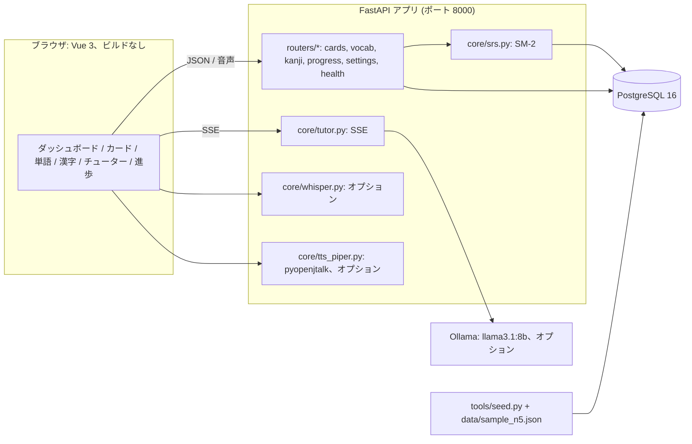

# 🗾 オフライン AI 日本語トレーナー

[](https://github.com/Karthik0000007/AI-Japanese-Learning-App/actions/workflows/ci.yml)

自分のパソコンで動く、日本語の勉強アプリです。
JLPT のレベル順にフラッシュカードで勉強できます。
復習の日は SM-2 というアルゴリズムが決めます。
単語と漢字を調べる画面もあります。
AI の先生(チューター)も使えますが、これはオプションです。
Docker のコマンド一つで起動できます。
インストールした後は、インターネットがなくても使えます。

English: [README.md](README.md)


| ダッシュボード | AI チューター | 漢字ブラウザ |
|---|---|---|
|  |  |  |

---

## クイックスタート

必要なのは [Docker](https://docs.docker.com/get-docker/) だけです。

```bash
docker compose up --build
```

ブラウザで **http://localhost:8000** を開きます。
最初の起動で、データベースが作られます。
次に、マイグレーションが実行されます。
そして、N5 のサンプル(単語 168 個と漢字 80 個)が入ります。
だから、すぐにフラッシュカードが使えます。
データは Docker のボリュームに保存されます。

**AI チューターも使う場合:**

```bash
docker compose --profile ai up --build
```

初めてのときは、Ollama と `llama3.1:8b` モデルをダウンロードします。
全部で約 5 GB です。

`ai` プロファイルがなくても、チューター以外は全部使えます。
チューターの画面には、使えるようにする方法が表示されます。
止めるときは `Ctrl+C` か `docker compose down` です。
データも消したいときは `-v` を付けます。

---

## 機能

- **SM-2 のフラッシュカード** — カードを Again / Hard / Good / Easy で評価します。次の復習の日はアプリが決めます。新しいカードは一日の数に上限があります。
- **JLPT の順番** — すべての単語と漢字に、N5 から N1 までのレベルがあります。
- **単語ブラウザ** — 単語、読み方、意味で検索できます。レベルでも絞り込めます。
- **漢字ブラウザ** — 音読み、訓読み、意味、画数が見られます。N5 サンプルの漢字には、例の単語もあります。
- **進歩のページ** — 連続で勉強した日数、正解率、レベルごとの進み具合、7 日間の復習予定が見られます。
- **AI チューター(オプション)** — モードは五つあります(TEACH、QUIZ、EXPLAIN、CORRECT、CHAT)。漢字にはふりがなを付けて答えます。ただ翻訳するだけのことはしません。答えは少しずつ流れるように表示されます。
- **音声入力と日本語の音声(オプション)** — 声でチューターに話せます(Whisper)。日本語の単語やチューターの答えを聞けます(pyopenjtalk)。
- **オフラインで、プライバシーも安心** — クラウドの API は使いません。チューターのモデルは自分のパソコンの Ollama で動きます。画面のライブラリもアプリの中に入っています。インターネットが必要なのは、インストールのときと、辞書や AI モデルを最初にダウンロードするときだけです。
- **AI がないときも分かりやすい** — 画面は `/api/health` を確認します。使えない機能のボタンは押せなくなります。そして、使えるようにする方法を表示します。

---

## アーキテクチャ



| 部分 | 技術 | 場所 |
|---|---|---|
| API サーバー | FastAPI + Uvicorn(非同期) | `main.py`、`routers/` |
| データベース | PostgreSQL 16、asyncpg、SQLModel | `models/`、`database/db.py` |
| マイグレーション | Alembic。起動のたびに実行 | `alembic/versions/0001`〜`0005` |
| 復習の計算 | SM-2。Python だけで書いた | `core/srs.py` |
| AI チューター | Ollama の HTTP API。SSE で送る | `core/tutor.py`、`routers/tutor.py` |
| 音声入力 | OpenAI Whisper(`base`)。オプション | `core/whisper.py`、`routers/speech.py` |
| 音声出力 | pyopenjtalk。オプション(ファイル名は昔のまま) | `core/tts_piper.py`、`routers/tts.py` |
| 画面 | Vue 3.5 + Vue Router 4.6 + DOMPurify。ファイルで同梱 | `templates/index.html`、`static/` |
| データ | JMdict + KANJIDIC2 | `tools/`、`data/sample_n5.json` |
| パッケージ | Docker Compose: `db`、`app`、`ollama`(`ai` プロファイル) | `Dockerfile`、`docker-compose.yml` |

主な API(`/docs` で試せます):

| メソッド | エンドポイント | 目的 |
|---|---|---|
| GET | `/api/health` | データベース、チューター、音声入力、音声出力の状態 |
| GET | `/api/cards/due` ・ `/api/cards/new` | 今日のカード ・ 新しいカード |
| POST | `/api/cards/review` | カードを評価する(`card_id`、`grade` 0〜5) |
| POST / PATCH | `/api/cards/sessions` | 勉強のセッションを始める / 終わる |
| GET | `/api/vocab` ・ `/api/kanji` | 一覧と検索 |
| GET | `/api/progress` | 連続日数、正解率、レベル、予定 |
| GET / POST | `/api/settings` | 勉強する JLPT レベル、一日の新しいカードの数 |
| POST | `/api/tutor/chat` | チューターの答え(SSE)。Ollama がないときは 503 |
| POST | `/api/tts` ・ `/api/speech-to-text` | 音声を出す ・ 音声を文字にする。ないときは 503 |

---

## SM-2 のしくみ

カードには、易しさの数字(最初は 2.5)、次の復習までの日数、成功した回数があります。
「Easy」だけがこの数字を上げます。「Good」は少し下げて、失敗はもっと下げます。でも 1.3 より下にはなりません。
評価が 3 より下(「Again」か「Hard」)なら失敗です。カードは 1 日後からやり直しになります。
成功したカードは、1 日後、6 日後、その後は「前の日数 × 易しさの数字」(切り上げ)の後に出てきます。
次の復習の日は「復習した日 + 日数」なので、覚えたカードはだんだん出なくなり、難しいカードはすぐまた出てきます。

---

## オプションの AI 機能と必要なパソコン

| 機能 | 使い方 | 必要なもの |
|---|---|---|
| AI チューター | Docker: `docker compose --profile ai up`。手動: [Ollama](https://ollama.com/download) を入れて、`ollama pull llama3.1:8b` | 8B モデルには、空いているメモリが **約 8 GB** 必要です。大きいモデル(`OLLAMA_MODEL`、例えば `llama3.1:70b`)は、40 GB 以上必要です。GPU があると速いですが、なくても動きます。 |
| 音声入力(Whisper) | 手動のセットアップ: `pip install -r requirements-speech.txt` | CPU で動きます。メモリは約 1 GB です。最初に `base` モデル(約 140 MB)をダウンロードします。 |
| 日本語の音声(pyopenjtalk) | 上と同じファイル | 軽いです。どの CPU でも動きます。 |

Docker のイメージを小さくする(323 MB)ために、音声のパッケージは入れていません。

---

## 手動のセットアップ(Docker なし)

Python 3.10〜3.12 と PostgreSQL 16 が必要です。

```bash
pip install -r requirements.txt
pip install -r requirements-speech.txt   # オプション: 音声入力と日本語の音声
cp .env.example .env                     # DATABASE_URL を書く
uvicorn main:app --reload                # 起動するとテーブルができる
python -m tools.seed --sample            # N5 サンプル。何回実行しても大丈夫
```

**http://localhost:8000** を開きます。

サンプルではなく**辞書全部**を使いたいときは、`python tools/setup.py` を実行します。
JMdict と KANJIDIC2(約 70 MB)をダウンロードして、全部データベースに入れます。
何回実行しても、データは重複しません。変えた設定も消えません。

`.env` の主な設定: `DATABASE_URL`、`OLLAMA_BASE_URL`、`OLLAMA_MODEL`、`WHISPER_MODEL`、`WHISPER_DEVICE`、`LOG_LEVEL`。
一日の新しいカードの数と JLPT レベルは、データベースに保存されます。`/api/settings` で変えます。

---

## テストの実行

SM-2 のテストは Python だけで動きます。
ほかのテストには、`jlpt_trainer_test` という PostgreSQL のデータベースが必要です。
Ollama、Whisper、音声出力は**いりません**。

```bash
docker run --rm -d --name jlpt-test-db -e POSTGRES_PASSWORD=postgres -e POSTGRES_DB=jlpt_trainer_test -p 5432:5432 postgres:16
pip install -r requirements.txt -r requirements-dev.txt
pytest -v
ruff check .
docker stop jlpt-test-db
```

ポートやパスワードが違うときは、`TEST_DATABASE_URL` を設定します。

CI([.github/workflows/ci.yml](.github/workflows/ci.yml))は、push と pull request のたびに、同じ lint とテストを `postgres:16` で実行します。

---

## 設計で決めたこと

**一人で使うアプリなのに、なぜ PostgreSQL?**
PostgreSQL の機能を実際に使っているからです。
漢字の読み方は JSONB の配列で保存して、GIN インデックスで速く検索します。
データを入れるときは `INSERT … ON CONFLICT DO NOTHING` を使います。だから、何回実行しても安全です。
非同期のサーバーは、同時にいくつもの処理をします(例えば、タブが二つのときや、チューターが答えている間に復習するとき)。SQLite だと、書き込みが一つずつになってしまいます。
それに、Docker Compose なら、ユーザーは PostgreSQL の準備を何もしなくていいです。

**チューターに、なぜ SSE を使う?**
チューターのデータは、サーバーからブラウザへの一方向だけです。だから WebSocket は必要ありません。
SSE はふつうの HTTP です。FastAPI の `StreamingResponse` で作れて、ブラウザは `fetch` で読めます。
どちらにも、新しいライブラリはいりません。
ふつうの HTTP なので、流し始める前なら、ふつうの `503` の JSON エラーも返せます。

**なぜ画面のビルドをしない?**
画面は六つだけです。
Vue、Vue Router、DOMPurify は、`static/vendor/` の三つのファイルです(バージョンとチェックサムは `VERSIONS.md`)。
Node.js も `npm install` も CDN もいりません。だから、オフラインで使えます。
その代わり、TypeScript やファイル一つのコンポーネントは使えません。このサイズなら、それで大丈夫です。

---

## データの出典

このアプリは **JMdict**(日英辞書)と **KANJIDIC2**(漢字辞書)を使っています。
これらのファイルは [EDRDG](https://www.edrdg.org/)(Electronic Dictionary Research and Development Group)のものです。
[EDRDG のライセンス](https://www.edrdg.org/edrdg/licence.html)に従って、[CC BY-SA 4.0](https://creativecommons.org/licenses/by-sa/4.0/) で使っています。

- JMdict: https://www.edrdg.org/wiki/index.php/JMdict-EDICT_Dictionary_Project
- KANJIDIC2: https://www.edrdg.org/wiki/index.php/KANJIDIC_Project

`data/sample_n5.json` は、`tools/build_sample.py` がこれらのファイルから作りました。同じ CC BY-SA 4.0 です。
漢字は、KANJIDIC2 で古い JLPT の 4 級(今の N5)の漢字です。
単語は、よく勉強する N5 の単語を私が選びました。読み方、意味、品詞は JMdict のものです。

---

## 次に良くしたいこと

1. **辞書全部の JLPT レベルを正しくする。** JMdict には JLPT の情報がありません。今は、辞書全部のレベルは推測です。ライセンスのある JLPT の単語リストを使いたいです。(N5 サンプルはもう正しいです。)
2. **新しいカードを入れる操作を、はっきり分ける。** `GET /api/cards/new` はカードも作ります。だから、ダッシュボードを開くだけで、一日の数を使ってしまいます。`POST` にして、復習を始めるときだけ呼びたいです。
3. **「Hard」でも進み具合を残す。** SM-2 では評価 2 は失敗なので、「Hard」はカードをやり直しにします。「Hard」に 3 か 4 を送れば、ユーザーの期待に合います。
4. **タイムゾーンのある日時にする。** 今はタイムゾーンなしで時間を保存しています。だから、SQLModel を 0.0.37 に固定しています。UTC の日時にすれば、アップグレードできます。
5. **画面のテスト。** Playwright で、復習の流れと「AI がない」のバナーをテストしたいです。
6. **昔の TTS の名前を整理する。** `core/tts_piper.py` の名前を変えて、`tools/setup.py` の古い Piper の設定とダウンロードを消したいです。
7. **文全体を読む。** 今のチューターの音声は、文全体ではなく、最後に届いた部分だけを TTS に送っています。
